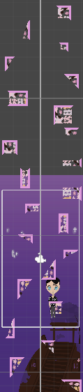

# Vertical Jump Builder

Генератор уровней в вертикальном платформере, процедурная генерация.

*Реализация*  -    *Демонстрация*  -  *Особенности*

## Реализация
Под блоком имеется ввиду один GameObject.
Под сценой множество блоков, создающих часть уровня в пределах экрана игрока.
Под уровнем перемещение сцен под движение игрока, чтоб сцены под ним переносились навверх. Ради оптимизации уровня.

Блок состоит из липкой и отталкивающих частей. 
- Сама отталкивающая часть имеет форму либо треугольника, либо квадрата (случайное значение).
- Липкая часть имеет форму граница отталкивающей части. Буквально генерируется по краям. Также случайное количество сторон. Но по проавилу одна сторона обязана быть отталкивающей.

Сцена генерируется в пределах экрана игрок.
Одновременно существует две сцены. Одна, на которой игрок. И вторая, которая перемещаетс за экраном.
Вы можете отдельно задавать количество блоков на сцене. Там используется промежуток случайных чисел от одного значени до другого.

Уровень является управляющим модулем. Сам по себе он ничего не генерирует, а управляет уже готовыми сценами в зависимости от положения камеры.

Так как уровень зависит от движения камеры, в проект была добавлена папка *cameraMovement* с ее реализацией. 

Также в проекте лежит скрипт игрока, но он не важен для генерации уровня. Вы спокойно можете использовать другую реализацию.

## Демонстрация

## Особенности
- Вам стоит учитывать, что движение камеры написано с фиксацией на осях X и Z. Так что вам стоит поменять код генерации сцены (Stage.cs) и уровня(level.cs), если у вас не так.

- Смотрите на перемещение в зависимости от длины экрана, если вам не хватает того дополнительного расстояния, измените параметры, чтобы сцена генерировалась  

 

> Честно говоря, оставлять readme на последок было плохой идеей. Нет интереса уже делать красивый тектст, так что ограничусь важными на мой взгляд замечаниями и минимальным описанием реализации. В любом случае, даже если кто-то взял мой код навооружение (в чем я очень сомневаюсь в наш век нейросетей), надеюсь тебе хватило заметок здесь. Потому что в коде я не оставила ни одного комментария (￣▽￣*)ゞ . Пока!  